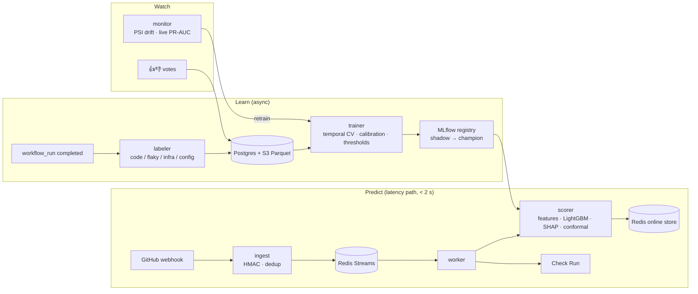

# Preflight

**Predicts whether a pull request will fail CI before the pipeline runs**, explains why in
plain language, suggests what would lower the risk, and reorders tests so the likeliest
failures run first. Delivered as a GitHub Check Run, a pre-push CLI and a pytest plugin.
It never blocks a merge.

```
🔴 High risk · 64% chance CI fails
Why
 ↑ `auth/session.py` failed 16 of the 42 builds that touched it (38% after smoothing)
 ↑ Files here usually change with `auth/tokens.py` (82% of the time), but it isn't in this change
 ↑ No tests changed, and `auth/session.py` has no matching test file
What would lower the risk
 Add or update tests for the changed code        64% → 41%
 Update the files that usually change with these 64% → 52%
CI plan: full-matrix · Tests most likely to fail run first
```
<sub>Illustrative output. Real checks render from the served model.</sub>

## Results

| Metric | Value | Source |
|---|---|---|
| Labelled builds / repos | _pending backfill_ | `scripts/label_report.py` |
| Noisy failures removed (flaky + infra) | _pending_ | `scripts/label_report.py` |
| PR-AUC: calibrated LightGBM vs logistic regression vs base rate | _pending_ | `scripts/eval_report.py` |
| ECE (calibration) | _pending_ | `scripts/eval_report.py` |
| APFD: model vs default order · median time-to-first-failure cut | _pending_ | `scripts/eval_report.py` |
| Scorer p95 latency | _pending_ | Grafana / `tests/load` |

Every number here will be copied from a report generated on real data. None are estimated.

## How it works



**Design decisions** (each one names the alternative it rejects):
- **Labels are a modelling problem.** A red build is often a flaky test or a dead runner. A failure taxonomy (rerun history → log rules → step names → TF-IDF classifier) keeps only real code defects as positives.
- **No leakage.** Every feature is computed as of the build's start by replaying history as events. A test deletes all future events and asserts the features don't change. CV is rolling-origin with a label-completion embargo, never random K-fold.
- **Trust over recall.** Isotonic calibration ("70%" means 7 in 10), a cost-based threshold that prices false alarms 3× misses, and conformal abstention ("not enough signal" instead of a coin flip).
- **Cold start.** A global cross-repo model with Bayesian-smoothed rates, and per-repo models only where they beat the global model.
- **Fail-open everywhere.** Scorer down or slower than 2 s → the check says "skipped" and CI runs normally.
- **Privacy.** Only diff stats and paths are stored, never source; log tails are redacted. Author IDs are hashed, and author features are never shown (blame-free mode turns them off).

## Run it locally

Needs Docker Desktop, [uv](https://docs.astral.sh/uv/) and Python 3.12.

```bash
cp .env.example .env                      # fill GITHUB_TOKEN; salts/secrets as noted inside
uv sync
docker compose up -d --build --wait       # postgres, redis, s3, ingest, scorer, worker, dashboard
docker compose --profile ops up -d        # + mlflow, prometheus, grafana, alertmanager, jaeger
```

| Service | URL |
|---|---|
| Dashboard | http://localhost:8501 |
| Scorer API | http://localhost:8001/docs |
| Grafana | http://localhost:3000 |
| MLflow | http://localhost:5000 |

### Pipeline, end to end
```bash
uv run python scripts/select_repos.py       # measure candidates → repos.yaml
uv run python scripts/backfill.py           # resumable (Ctrl+C safe)
uv run python scripts/label.py              # taxonomy labels
uv run python scripts/label_report.py       # label breakdown
uv run python scripts/build_features.py     # point-in-time features → Postgres + Parquet
uv run python scripts/eval_report.py        # baselines, ablations, calibration, APFD
uv run python scripts/train.py              # bundle → MLflow candidate
uv run python scripts/promote.py promote <version> --force   # first champion
uv run python scripts/materialize.py        # online store
```

### Use it
```bash
preflight check                 # score your local change before pushing
preflight install-hook          # ...on every git push (informational, never blocks)
pytest --preflight              # run likely-failing tests first
```

## Operate
- **Deploy:** push to `main` runs lint → test → build → ECR → staging → smoke → approval → prod ([infra/README.md](infra/README.md)).
- **Model lifecycle:** `scripts/promote.py shadow|evaluate|promote`; `scripts/rollback.py` is one command.
- **Watch:** an hourly monitor pushes PSI drift and live PR-AUC to Prometheus. Alerts go to Slack, and retraining triggers on drift, a performance drop or weekly.
- **Load test:** `uv run locust -f tests/load/locustfile.py --headless -u 60 -r 20 -t 2m --host http://localhost:8000`

## Tests
```bash
uv run pytest                    # unit (includes leakage, parity, behavioural, latency tests)
uv run pytest -m integration     # needs `docker compose up` (separate preflight_test DB)
```

## Repo layout
```
apps/{ingest,scorer,worker,dashboard}   services
preflight_core/
  backfill/  labeling/                  data foundation, failure taxonomy
  features/                             point-in-time feature engine (train = serve)
  models/                               baselines, LightGBM, calibration, SHAP, what-ifs, test ranker
  online/  serving/  monitoring/        Redis store, scoring, drift
cli/  pytest_plugin/                    developer entry points
infra/terraform  infra/monitoring       AWS (ECS Fargate, RDS, ElastiCache, S3, Secrets Manager), Prometheus/Grafana
docs/SPEC.md  docs/ROADMAP.md           spec and coverage map
```
